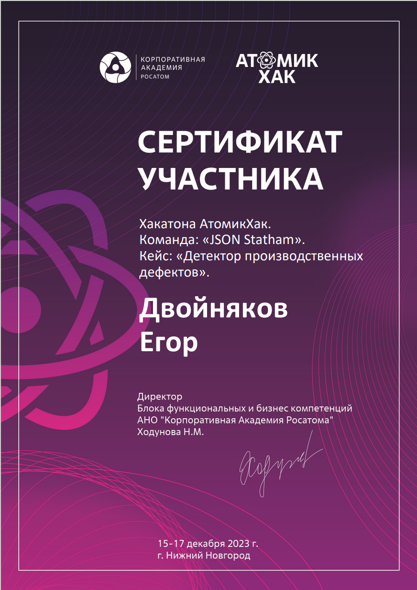
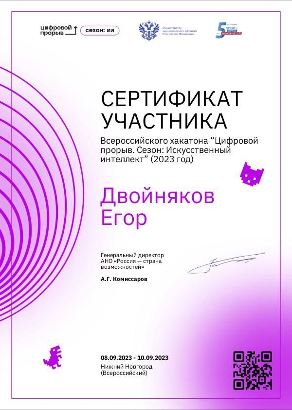
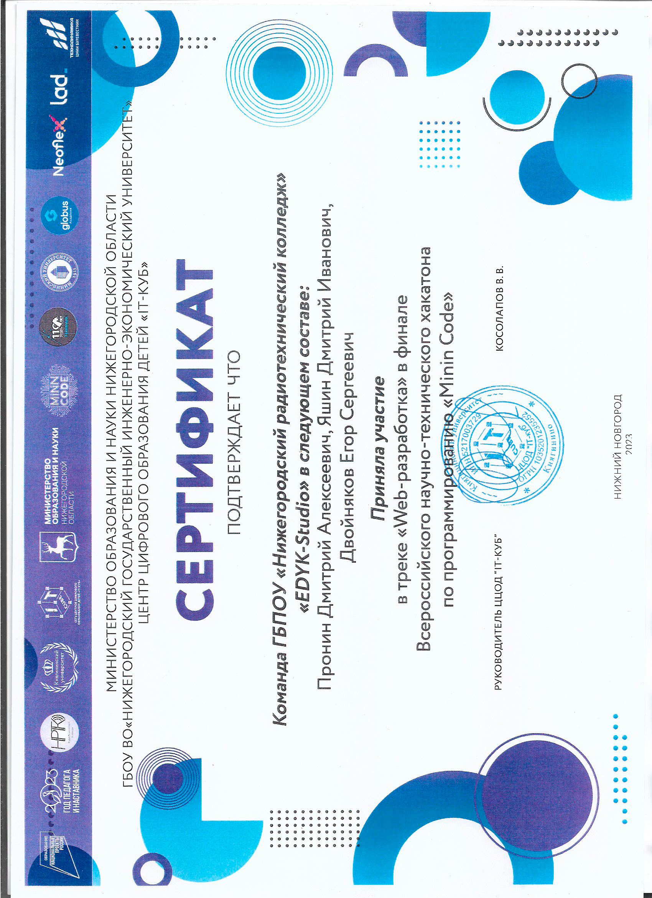
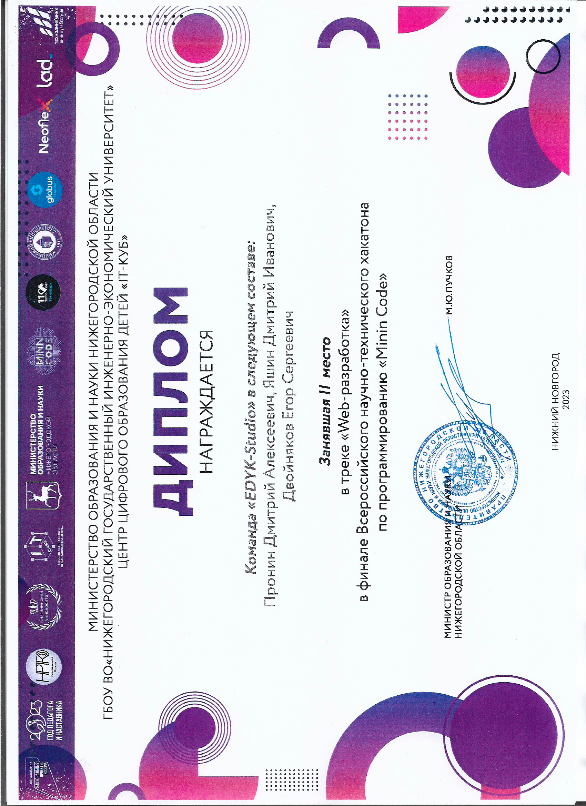
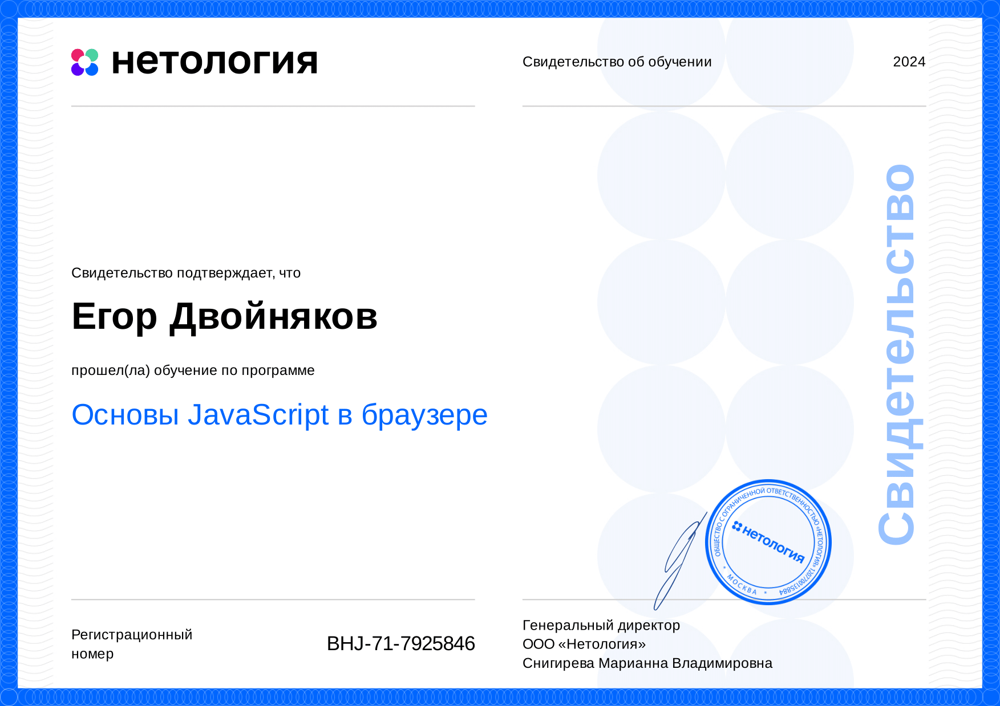
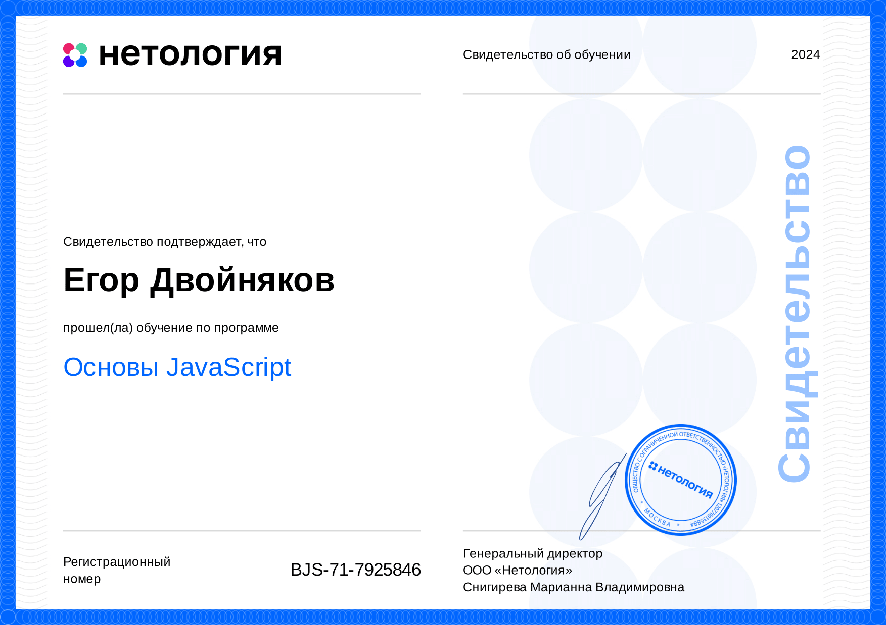
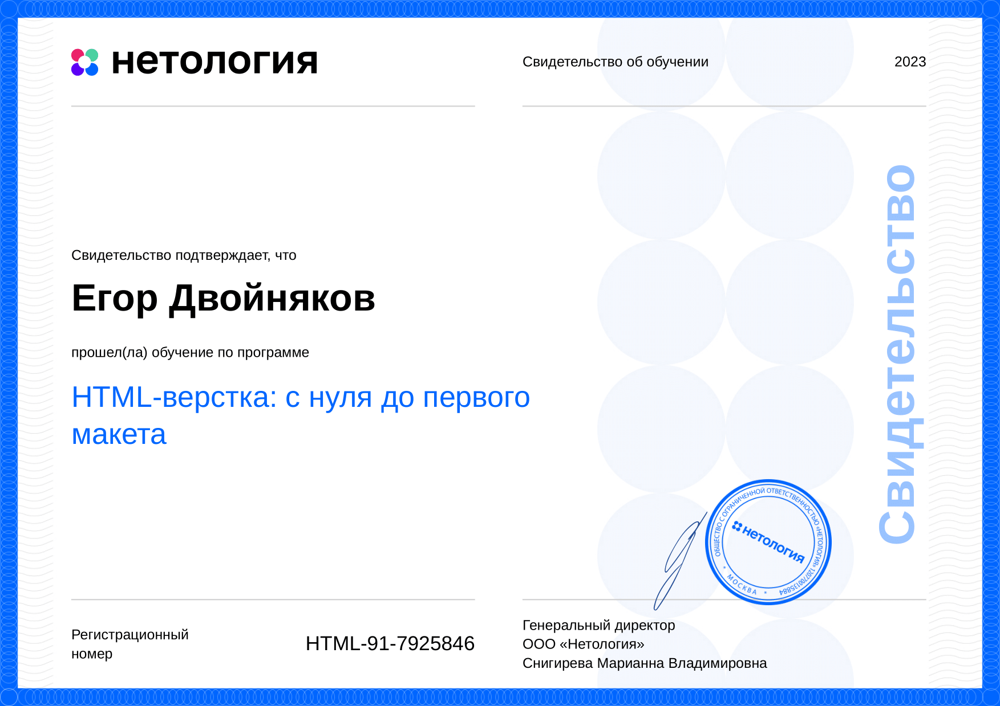
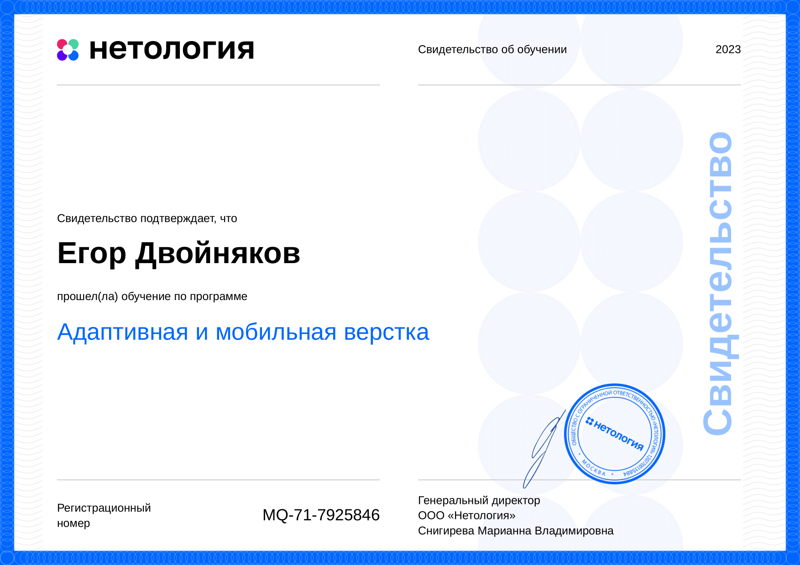
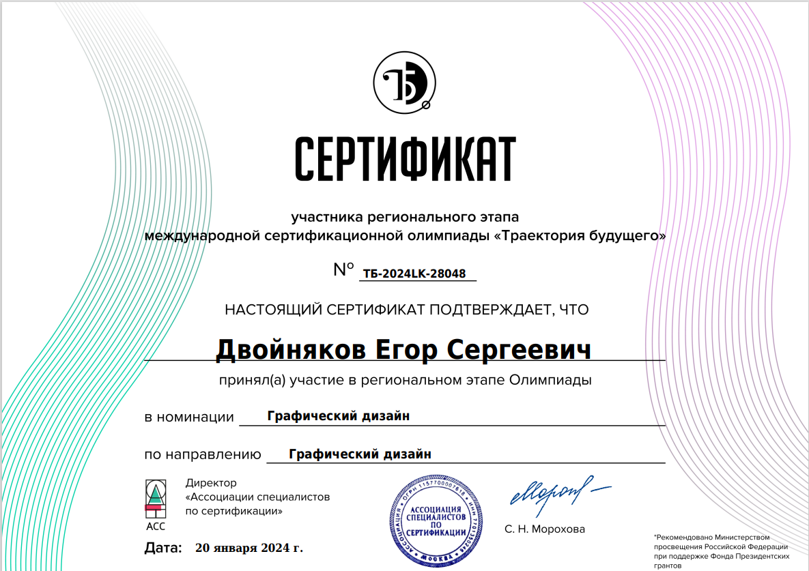

# Jegor — Frontend Developer @ ЦЭМП Москвы

Frontend developer with commercial production experience and a freelance background.
I build web products end to end: React/TypeScript interfaces, WebGL/3D views, and the
Node.js/Python backends behind them.

## Tech stack

     

## Projects

| Project | Demo | What it is |
|---|---|---|
| **[evolution-online](https://github.com/jegorRegularUser/evolution-online)** | [Live](https://evolution-online.vercel.app) | In-browser evolution game. React + three.js/cannon-es, pglite persistence, auth, tested engine. |
| **[intelligent-trails](https://github.com/jegorRegularUser/intelligent-trails)** | — | My graduation project: an app for planning walks. Next.js app is the main part (an early PHP draft is kept in the repo), Yandex Geocoder API. |
| **[form-constructor](https://github.com/jegorRegularUser/form-constructor)** | — | Drag-and-drop form builder. Angular 19 + Ng-Zorro, MIT-licensed, fully documented. |
| **[avito-test](https://github.com/jegorRegularUser/avito-test)** | — | Classifieds app (test task). React 19 + TypeScript + Express, Jest + Testing Library tests. |
| **[sexism-detection](https://github.com/jegorRegularUser/sexism-detection)** | [Live](https://jegorregularuser.github.io/sexism-detection/) | ML mini-project: flags sexist wording in a message, hosted on GitHub Pages. |

## Certificates

<b>Courses & certificates</b> — click to expand

 
<!-- TODO before/right after this commit:
     1. Delete photos/ML TALENT хакатон.pptx (8.3 MB) and photos/Атомик хак.pptx (24.9 MB) from the repo —
        they are ~33 MB of dead weight and are the main reason the profile repo is ~50 MB.
     2. Compress photos/*.png to ~800px width and <150 KB each. -->

## GitHub stats

<!-- github-readme-stats.vercel.app is currently returning 503 (deployment paused),
     so cards below come from github-profile-summary-cards instead. Verified live. -->
|  |  |
|---|---|
|  |  |

## Contact

 
# Jegor — Frontend Developer @ ЦЭМП Москвы

Frontend developer with commercial production experience and a freelance background.
I build web products end to end: React/TypeScript interfaces, WebGL/3D views, and the
Node.js/Python backends behind them.

## Now working on

- **[evolution-online](https://github.com/jegorRegularUser/evolution-online)** → [Live demo](https://evolution-online.vercel.app)
  An in-browser evolution game: React + TypeScript UI, three.js + cannon-es 3D world,
  pglite (PostgreSQL compiled to WebAssembly) for persistence, auth, and a game engine
  covered by tests.
- **[intelligent-trails](https://github.com/jegorRegularUser/intelligent-trails)**
  A full-stack travel route planner: FastAPI backend, TypeScript SPA, Yandex Geocoder
  API integration. 200+ commits across the codebase.

## Tech stack

Day-to-day libraries: TanStack Router / Query / Table · zustand · zod · i18next · better-auth · pglite

## Projects

| Project | Demo | What it is |
|---|---|---|
| **[evolution-online](https://github.com/jegorRegularUser/evolution-online)** | [Live](https://evolution-online.vercel.app) | In-browser evolution game. React + three.js/cannon-es, pglite persistence, auth, tested engine. |
| **[intelligent-trails](https://github.com/jegorRegularUser/intelligent-trails)** | — | Travel route planner. FastAPI + TypeScript SPA + Yandex Geocoder API, 200+ commits. |
| **[form-constructor](https://github.com/jegorRegularUser/form-constructor)** | — | Drag-and-drop form builder. Angular 19 + Ng-Zorro, MIT-licensed, fully documented. |
| **[avito-test](https://github.com/jegorRegularUser/avito-test)** | — | Classifieds app (test task). React 19 + TypeScript + Express, Jest + Testing Library tests. |
| **[phazer3-games](https://github.com/jegorRegularUser/phazer3-games)** | [Play](https://jegorregularuser.github.io/phazer3-games/) | Browser games on Phaser 3 — my most-starred repo (8 stars). |
| **[sexism-detection](https://github.com/jegorRegularUser/sexism-detection)** | [Live](https://jegorregularuser.github.io/sexism-detection/) | ML mini-project: flags sexist wording in a message, hosted on GitHub Pages. |

## Certificates

<b>Courses & certificates</b> — click to expand

 
<!-- TODO before/right after this commit:
     1. Delete photos/ML TALENT хакатон.pptx (8.3 MB) and photos/Атомик хак.pptx (24.9 MB) from the repo —
        they are ~33 MB of dead weight and are the main reason the profile repo is ~50 MB.
     2. Compress photos/*.png to ~800px width and <150 KB each. -->

## GitHub stats

<!-- github-readme-stats.vercel.app is currently returning 503 (deployment paused),
     so cards below come from github-profile-summary-cards instead. Verified live. -->
|  |  |
|---|---|
|  |  |

## Contact

 

### In brief about me:
I'm beginner front-end developer and college student, studying to become a programmer.

 I often participate in various IT events.

## Languages and tools:

  

    
   

 

## My achievements:

## Statistic:

